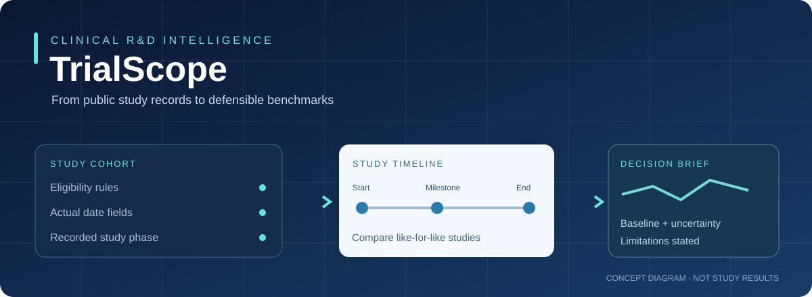
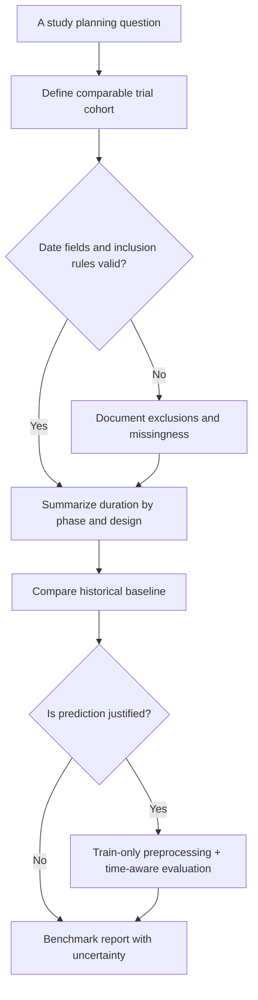

<strong>Clinical research operations · Study benchmarking · Transparent prediction</strong>

<a href="https://clinicaltrials.gov/data-api/about-api">Official data</a> · <a href="#the-analytical-case">Analytical case</a> · <a href="#investigation-plan">Investigation</a> · <a href="#learning-lab">Learning lab</a> · <a href="#interview-story">Interview story</a>

> [!NOTE]
> **Planning stage — no study records processed or numerical results reported yet.** The illustration is an original explanatory schematic, not an analysis chart.

## The analytical case

**Could a clinical operations team defend its proposed study timeline using a transparent benchmark of comparable historical trials?**

Trials vary in phase, intervention, disease area, design, and enrollment. A headline average across all trials would mislead decision-makers. TrialScope will build a reproducible *cohort definition* first, then explore the variation in reported study timelines.

| Industry stakeholder | Their decision | What our analysis can honestly contribute |
|---|---|---|
| Clinical operations | Is a proposed timeline plausible? | Historical duration distributions for comparable records |
| Portfolio strategy | Where does uncertainty come from? | Transparent summaries and sensitivity checks |
| Data science | Does prediction add value? | A baseline-versus-model comparison using eligible predictors |

### Define the outcome *before* modeling

- **Observation:** one registered study, not one participant.
- **Outcome candidate:** time between **actual** study start and **actual** primary completion date; final definition to be documented after checking fields.
- **Eligible subset:** an explicitly defined selection of interventional studies with interpretable records.
- **Primary caution:** do not use revised enrollment, post-start status, or other future information as if available at initial planning.

## Investigation plan

**Analytical questions**

1. What is the distribution—not just the mean—of actual study duration in the selected cohort?
2. How do patterns differ by trial phase, enrollment, and intervention type?
3. How sensitive are comparisons to date completeness and eligibility definitions?
4. If meaningful, can a simple duration model improve on an honest baseline?

## Learning lab

| Order | Concept to master | Python / SQL evidence to produce |
|:--|:--|:--|
| 01 | Observation, variable, type, outcome | Inspect one JSON record and map useful columns |
| 02 | Missingness and cohort selection | Explain every exclusion with counts |
| 03 | Distributions and uncertainty | Histograms, medians, quantiles, sample sizes |
| 04 | SQL relational analysis | Query by phase and study characteristics |
| 05 | Regression and generalization | Compare a simple baseline with a model *if justified* |
| 06 | Leakage and limitations | Show which fields are unavailable at prediction time |

<strong>What must be true before claiming results?</strong>

- [ ] Retrieval date, source query, and definitions are recorded.
- [ ] Actual and estimated dates are not mixed without an explicit rule.
- [ ] The denominator and excluded studies are visible.
- [ ] Baselines, validation rules, and model variables are declared before performance comparison.
- [ ] All figures can be regenerated from documented code.
- [ ] Final interpretation distinguishes benchmarking, prediction, and causation.

## Data contract

**Official source:** [ClinicalTrials.gov Data API](https://clinicaltrials.gov/data-api/about-api). Public registration records have inconsistent completeness and time-varying updates. Data extraction, eligible fields, and retrieval dates will be documented before results are added.

**Planned output:** a small, inspectable clinical trial benchmark report, supporting SQL and notebooks, and optional interactive exploration only after results are validated.

## Interview story

> *A clinical operations manager asks whether a proposed 24-month trial timeline is realistic.*

I should be able to explain how I chose comparable trials, why I report a distribution rather than a single average, what information was missing, whether predictive modeling added anything, and why none of this proves a trial will complete on schedule.

**Project milestones:** [ ] Cohort defined · [ ] Data audited · [ ] Statistics interpreted · [ ] SQL verified · [ ] Model decision justified · [ ] Findings published

---
Other industry analytics projects: <a href="https://github.com/mbilal-OU/PharmaSpend">PharmaSpend</a> (commercial analytics) · <a href="https://github.com/mbilal-OU/SafeSignal">SafeSignal</a> (pharmacovigilance)

<a href="https://mbilal-ou.github.io/portfolio/">Research portfolio</a> · <a href="https://github.com/mbilal-OU">GitHub</a>
