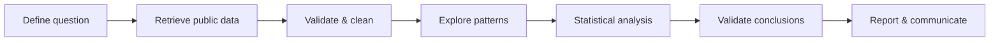

<div align="center">

# TrialScope
### Clinical R&D · Trial performance intelligence

**Real-world data · Reproducible analytics · Industry-focused learning**


[Why this project?](#why-this-project) · [Research questions](#research-questions) · [Learning roadmap](#learning-roadmap) · [Data](#data-source) · [Interview case](#interview-case)

</div>

> [!IMPORTANT]
> **Project stage: planning.** This repository defines a learning and analysis plan, not completed research. No dataset has been acquired or analyzed here yet. We will publish results only after running and verifying the code.

## Why this project?

TrialScope explores real clinical trial records to understand trial characteristics and historical timelines. The goal is a defensible benchmark for research planning—not a system that promises individual trial success.

**Decision problem:** How do study design, phase, enrollment, and therapeutic area relate to observed trial duration?

## Research questions

1. How do reported durations vary across clinical phases?
2. How do enrollment and study design relate to observed duration?
3. What distinguishes completed versus terminated studies in a clearly defined cohort?
4. Can a simple duration predictor beat a transparent baseline using only information available at prediction time?

## At a glance

| Dimension | Scope |
|:--|:--|
| Industry | Clinical R&D |
| Source | [ClinicalTrials.gov — API and data downloads](https://clinicaltrials.gov/data-api/about-api) |
| Data type | Public, observational records |
| Analytical approach | Descriptive analysis first; statistical modeling only when justified |
| Key outcome | Transparent, reproducible findings—not a performance score alone |
| Current stage | **Planned — no reported results** |

## Analysis workflow



## Learning roadmap

- [ ] **01 · Understand the data** — Define a study, fields, dates, status, and the unit of analysis
- [ ] **02 · Acquire a small cohort** — Retrieve actual public records; document filters and download date
- [ ] **03 · Clean and audit** — Check dates, missing fields, inconsistencies, and study eligibility
- [ ] **04 · Explore** — Summarize durations, cohorts, and uncertainty with clear plots
- [ ] **05 · Learn SQL** — Create and query a small relational clinical-trial dataset
- [ ] **06 · Model carefully** — Start with baselines, then regression if justified
- [ ] **07 · Communicate** — Produce an evidence-based trial benchmarking brief

<details>
<summary><strong>📘 What I want to learn</strong> — expand</summary>

- Python basics: pandas, CSV/JSON, types, missing data
- SQL: SELECT, WHERE, JOIN, GROUP BY
- Statistical summaries, variation, uncertainty, regression
- Temporal validity: avoid using information recorded after a prediction date
- Baseline comparison and evaluation metrics
- Research communication for clinical operations

**Learning rule:** Before adding a method, document what it measures, why it is appropriate, basic assumptions, Python implementation, actual output, and its limitations.

</details>

<details>
<summary><strong>🧪 Validation and reproducibility standards</strong> — expand</summary>

- Keep original source files immutable and document retrieval dates.
- Define the unit of observation, inclusion criteria, and outcome variables.
- Inspect missingness, duplicate records, inconsistent definitions, and potential selection bias.
- Establish a simple baseline before using more complex models.
- Separate training and validation information for any predictive analysis; avoid leakage.
- Record important methodological decisions **before** comparing candidate results.
- Publish reproducible instructions and dependency versions.
- Distinguish association, prediction, and causation.

</details>

## Data source

[ClinicalTrials.gov — API and data downloads](https://clinicaltrials.gov/data-api/about-api)

We will document source URLs, access dates, field definitions, terms of use, and any cleaning rules before producing findings. **Do not commit private or sensitive data.**

## Proposed repository layout

```text
TrialScope/
├── README.md
├── data/
│   └── README.md                 # provenance and download instructions
├── notebooks/                    # sequential, explainable analyses
├── sql/                          # SQL queries, where appropriate
├── figures/                      # verified exported results
├── results/                      # reproducible outputs
└── docs/
    ├── learning_log.md
    ├── project_decisions.md
    └── glossary.md
```

> This is a **target layout**, not a claim that these directories have already been created.

## Expected deliverables

- [ ] Documented, reproducible acquisition and cleaning notebook
- [ ] SQL exploration of trial characteristics
- [ ] Verified descriptive statistics and graphics
- [ ] Baseline-versus-model evaluation if justified
- [ ] Concise clinical operations interpretation

## Interpretation guardrails

- Trial records may contain estimated dates; distinguish them from actual reported dates.
- Reporting completeness and selection into the database may bias comparisons.
- Associations do not establish causes of trial delay.
- Retrospective duration predictions may be misleading if input variables were unavailable at trial start.

## Interview case

> **Question a stakeholder might ask:** Could we benchmark a proposed 24-month study against historical trials?

**What this portfolio should demonstrate:** The ability to filter comparable records, report variability and missingness, evaluate a model without hindsight leakage, and communicate uncertainty.

<details>
<summary><strong>🎤 Interview preparation checklist</strong> — expand</summary>

- [ ] Explain the business or research decision in one minute.
- [ ] Explain data sources, inclusion criteria, and dataset limitations.
- [ ] Walk through the SQL / Python transformations independently.
- [ ] Explain why the statistical method or model is appropriate.
- [ ] Present verified numerical findings (never placeholders).
- [ ] Describe an alternative explanation and an important limitation.
- [ ] Explain what a stakeholder could reasonably do next.

</details>

---

<div align="center">

**Part of an industry Data Science learning series**

[TrialScope](https://github.com/mbilal-OU/TrialScope) · [PharmaSpend](https://github.com/mbilal-OU/PharmaSpend) · [SafeSignal](https://github.com/mbilal-OU/SafeSignal)

[Research portfolio](https://mbilal-ou.github.io/portfolio/) · [GitHub profile](https://github.com/mbilal-OU)

<sub>Maintained as a transparent learning and research portfolio. Claims and results will be added only after independent verification.</sub>

</div>
